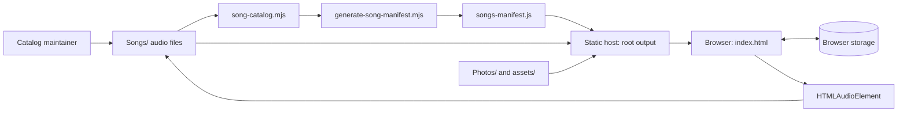

# Tonearm Music Player — System Design

**Version:** 0.1 · **Date:** 15 October 2026  
**Status:** As-built description with clearly marked proposed safeguards. No architecture or source changes are authorized by this document alone.

## 1. Design summary

Tonearm is a static client-side web application. `index.html` owns the interface, hash router, song/player state, and persistence. `songs-manifest.js` is loaded before the app script. Audio and artwork are fetched as relative static assets. Node.js scripts maintain the manifest before deployment.

There is no app server, database, account service, package/build pipeline, or runtime directory watcher in the checked-out repository. Vercel serves the repository root as static output. A GitHub Actions workflow now runs the catalog and exact-case active asset verifier on pushes and pull requests; a hosted workflow run has not yet been observed. `scripts/app-player-check.html` embeds the real app on the same origin and records observed UI/media interactions without adding a test framework or server component.

## 2. Context and container view



**Important boundary:** the browser can read files that are deployed at known URLs, but cannot continuously enumerate the host’s `Songs/` directory. A catalog update requires manifest generation and deployment; the user’s browser then loads the new catalog on a page load/refresh.

## 3. Code/component view

| Component | Current responsibility | Main source |
| --- | --- | --- |
| Static page shell | App grid, nav, main region, player, dialog and toast containers | `index.html` markup |
| Styles and responsive rules | Theme variables, cards, song rows, player, breakpoints, reduced-motion overrides | `<style>` in `index.html` |
| Catalog adapter | Validates manifest entries, creates track maps and relative encoded paths | `catalogFromManifest`, `TRACKS`, `TRACK_BY_ID`, `TRACK_BY_FILE` |
| Playlist rules/store | Curated seed files, generated mood rules, built-in playlist protection, persistence/migrations | `CURATED_PLAYLISTS`, `MOOD_PLAYLISTS`, `S`, store initialization |
| Views/router | Home/search/library/artist/album/playlist/queue/liked/recent rendering from URL hash | `V`, `shell()`, `route()` |
| Playback controller | Queue index, audio source, playback promises, progress, volume, shuffle/repeat | `P`, shared `Audio`, `syncPlayer()` |
| Rendering helpers | Track rows/cards, cover assignments, playlist membership labels, dialogs | `trackRow()`, `tCover()`, `playlistCover()`, dialog helpers |
| Catalog maintenance | Scan, metadata extraction, stable IDs, manifest generation, parity checks | `scripts/*.mjs` |
| Browser smoke page | Isolated audio load/seek/play/pause/volume check per manifest entry | `scripts/playback-check.html` |

The code is intentionally dependency-light, but a large share of presentation and behavior is coupled in one HTML file. Proposed modularization is deferred until automated tests protect current behavior.

## 4. Runtime sequence: select and play a track

```mermaid
sequenceDiagram
  actor Listener
  participant View as Track row/card
  participant App as App event handler / P
  participant Audio as HTMLAudioElement
  participant UI as Player rendering

  Listener->>View: Select song
  View->>App: Track ID + list context/index
  App->>App: Resolve valid queue IDs and selected track
  App->>Audio: pause old source; set encoded URL; load; play
  App->>UI: Show selected title/artwork/loading state
  Audio-->>App: metadata/time/play/error events
  App->>UI: Update duration, progress, and playback state
```

The current controller uses a request counter around `play()` promises to reduce stale completion updates during rapid song changes. Runtime verification of error-event ordering, queue edge cases, and control synchronization remains outstanding; see `TEST_PLAN.md`.

## 5. Catalog data model and flow

```text
Songs/<basename> ──scan──► Song record ──serialize──► window.TONEARM_SONGS
                                  │                         │
                                  ├── stable ID              └── startup validation
                                  ├── title / artist / album           │
                                  ├── duration / addedAt                ▼
                                  └── file path                 client TRACKS + lookup maps
```

Manifest record fields currently include numeric filename-derived `id`, basename `file`, `title`, project `artist`, `album`, `durationSeconds`, and `addedAt`. The client derives a relative URL using the encoded filename. Playlist arrays store IDs rather than song objects.

### Playlist categories

| Category | Membership source | Mutability |
| --- | --- | --- |
| Popular | Every current track in manifest | Generated/read-only |
| Curated permanent | Fixed filenames + stored approved song IDs | Names protected; curated seed membership retained |
| Mood mix | Title/filename regular expressions and curated seeds | Generated/read-only |
| User permanent | Browser `localStorage`, song IDs | User-editable subject to permanent-song protection rule |
| User temporary | Browser `sessionStorage` playlist records; runtime-only temporary song additions | Session-only/editable |

## 6. Persistence design

| Data | Current storage | Lifetime / limitation |
| --- | --- | --- |
| Catalog and song metadata | Deployed `songs-manifest.js` | Changes only after regenerate/deploy and client reload |
| Audio/artwork files | Static files in `Songs/`, `Photos/`, `assets/` | Available while included in deployment |
| Liked and recent IDs, volume/mute, curated additions, playlist timestamps, permanent custom playlists | `localStorage` key `tonearm-music-v3` | Current browser profile and origin; subject to user/browser clearing and quota |
| Temporary playlist definitions | `sessionStorage` key `tonearm-temporary-playlists-v1` | Tab browsing session semantics vary with browser restore behavior |
| Temporary song additions | Runtime state | Lost on refresh |
| Playback queue/current source | Runtime state + media element | Not durable across page reload |
| Portable playlist backup | Downloaded/imported versioned JSON | User moves it manually; no auto-sync |

## 7. Deployment architecture

1. Keep `index.html`, manifest, `Songs/`, `Photos/`, and `assets/` in the repository root tree.
2. Before publishing a catalog change, run the generator and verifier.
3. Deploy the root directory with no build or dependency install command.
4. Test root and deep hash routes after refresh, relative paths, case-sensitive names, and representative audio formats.

This approach is appropriate while the app has no server-managed identity or cross-device data requirement. If true synchronization becomes a confirmed requirement, it needs a separately designed service with identity, storage, access control, privacy, backup, and cost decisions.

## 8. Design risks and proposed controls

| Risk | Current evidence | Proposed control |
| --- | --- | --- |
| Manifest and file tree diverge | Static build-time generation | Make catalog verification a deployment gate (FR-003 / BL-01). |
| User assumes local playlists are cloud-backed | Browser storage only | Show origin/profile scope; retain JSON export/import (FR-013/019). |
| Audio event races during rapid selection | Shared media element, promise request counter | Add application-level race/failure tests and guard only verified stale events (FR-008/009). |
| Large media payload | 78 audio files and multi-megabyte PNG artwork | Measure real transfer first; optimize only approved assets after baseline (NFR-001). |
| One-file coupling | Most app code in `index.html` | Stabilize tests, then extract boundaries incrementally (NFR-008). |
| Mood classification errors | Regex-driven terms | Add reviewed tags/override policy before expanding automation (FR-016). |

## 9. Decision record

- **Static-first:** retain the existing no-backend design for this proposal; it meets current deployment constraints.
- **Single song library:** manifest remains the only song catalog; playlists contain IDs.
- **No filesystem-watcher fiction:** runtime synchronization means a new manifest is deployed and loaded, not that an open static page watches the server.
- **No premature framework:** make code structure changes only where testability or measured maintenance needs justify them.
